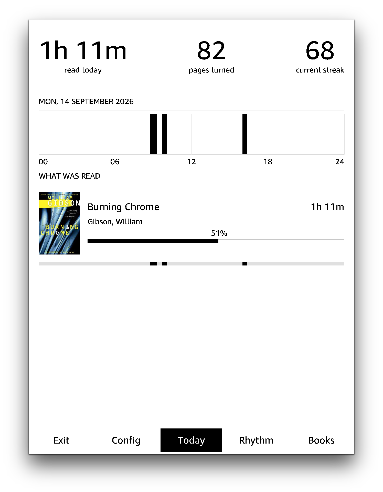
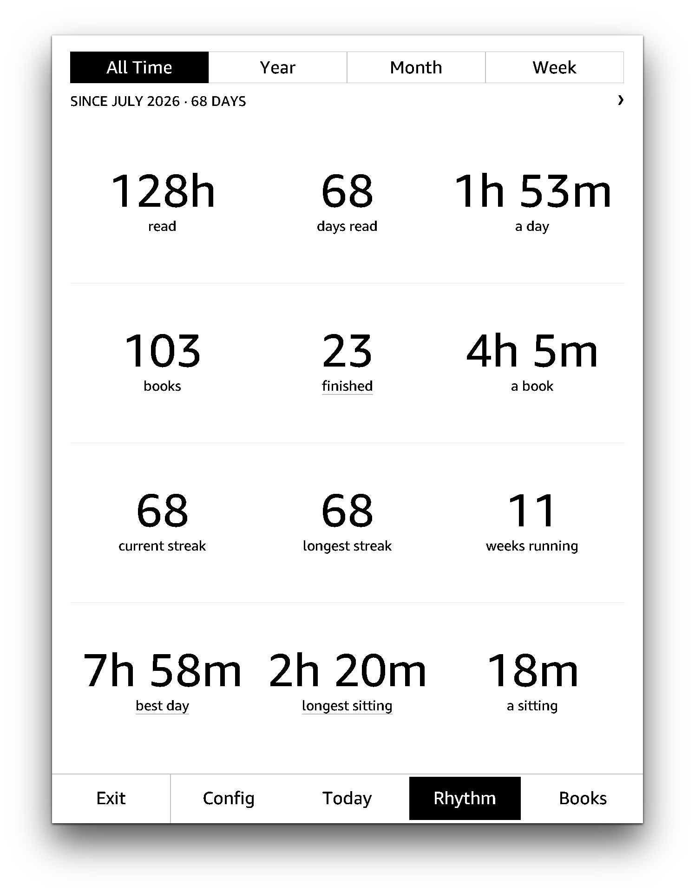
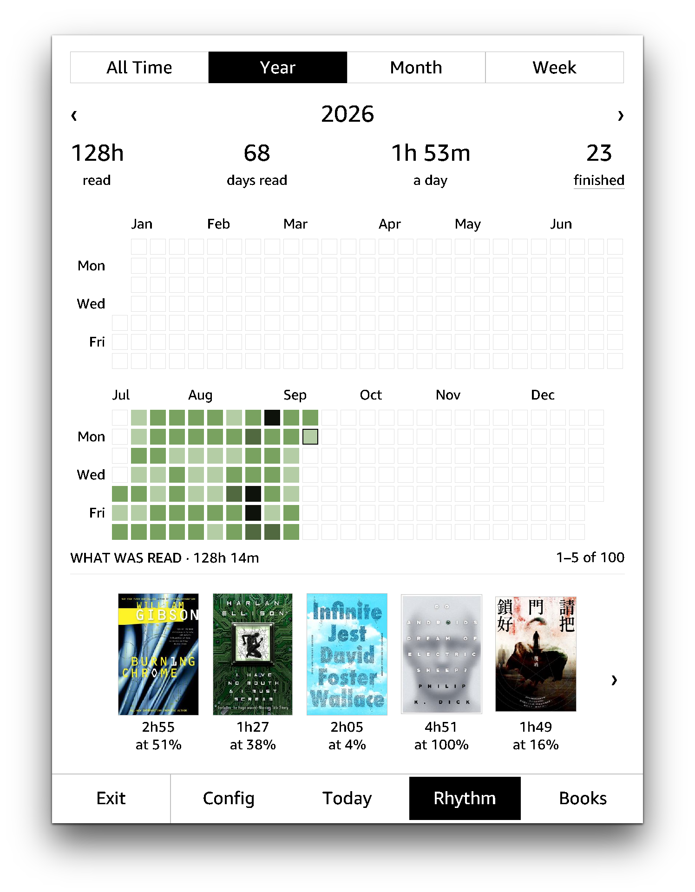
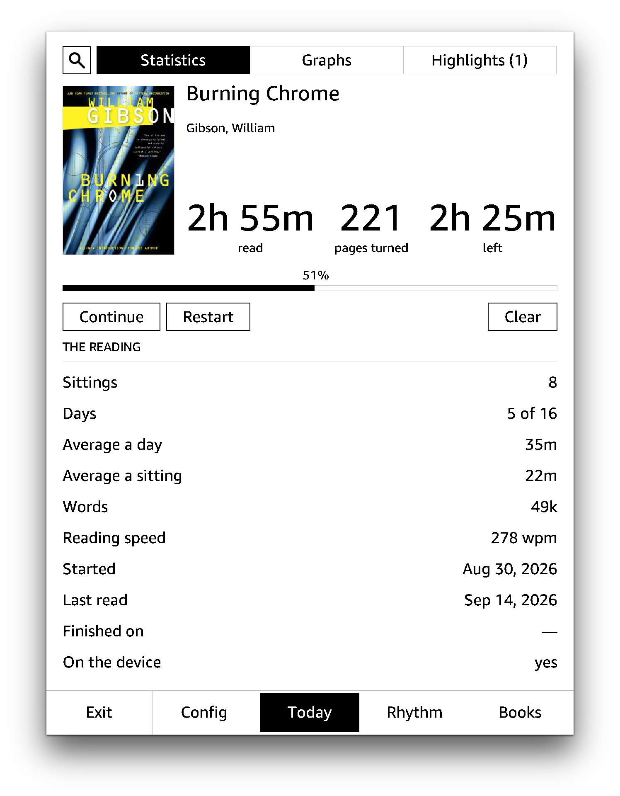
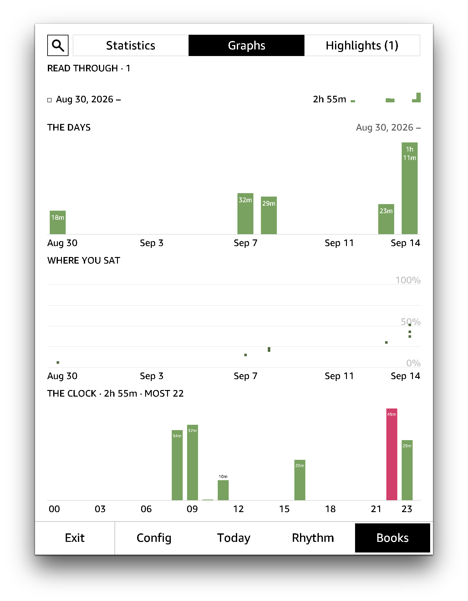
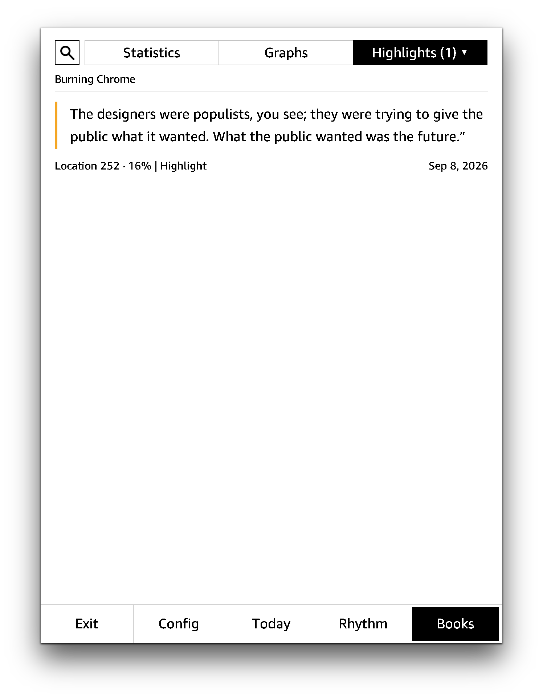
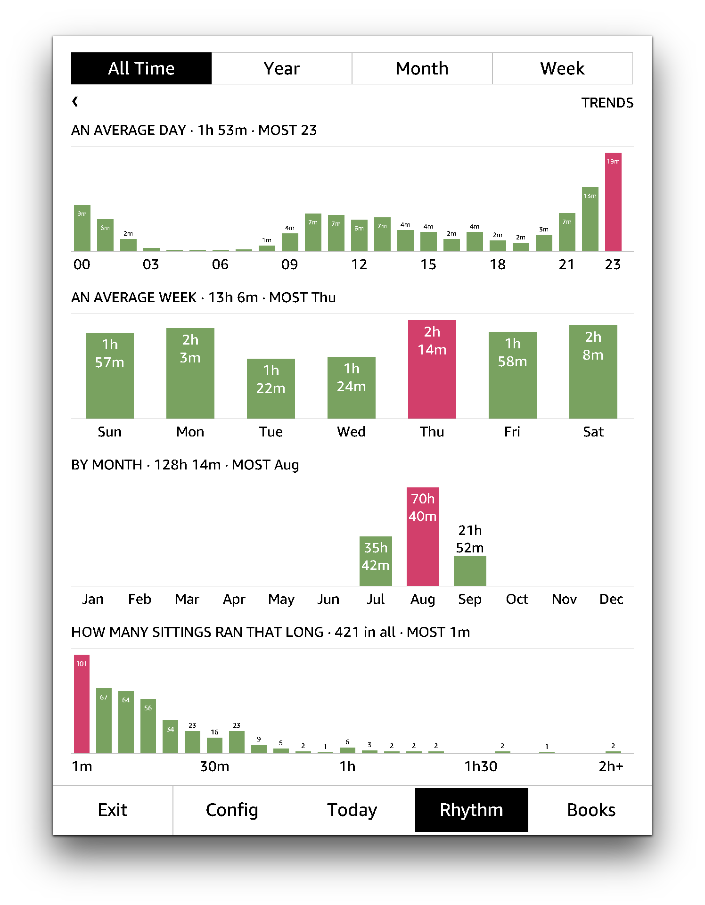
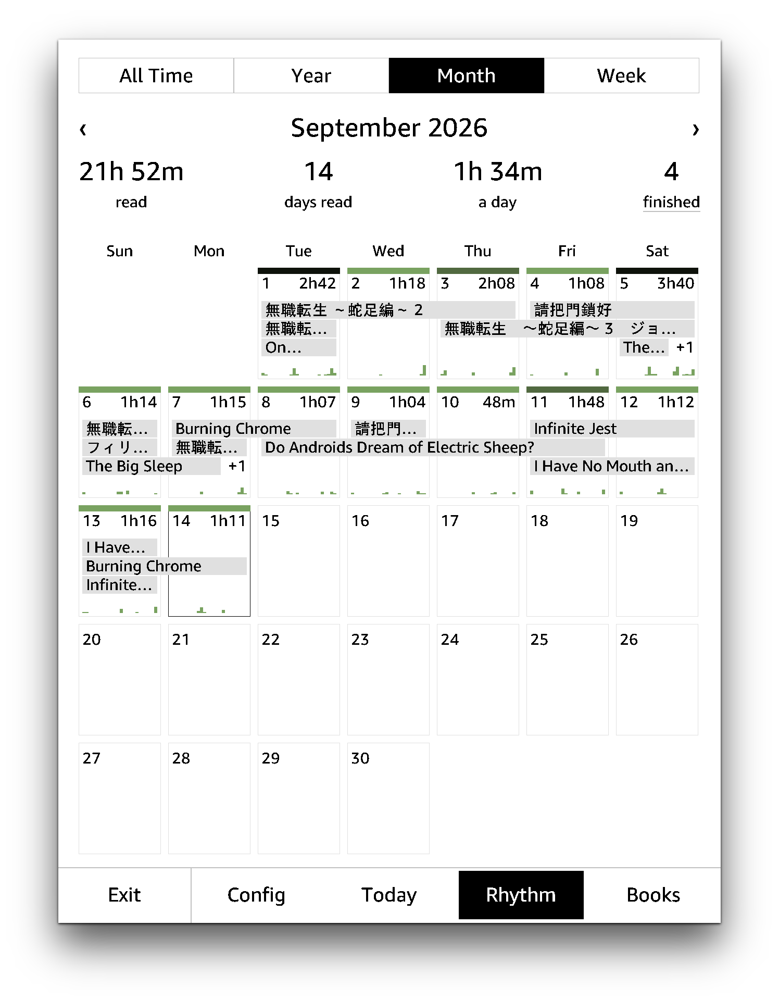
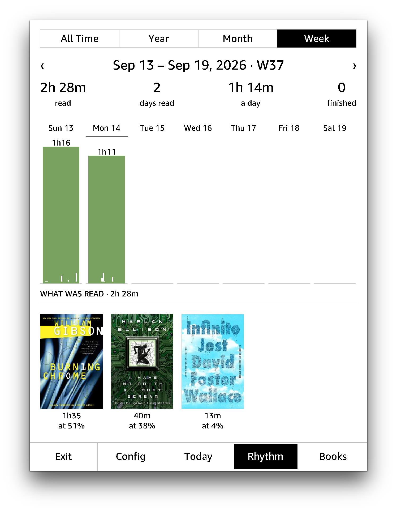

# Reading Log

Keep track of your reading stats by parsing the local system logs on your jailbroken Kindle.  

<p align="center">
    
    
    
</p>

Reading Log does not track or record any reading data, it only parses what are already on the Kindle. It works best on firmware from 5.16.* to 5.18.* because their system logs are better known. It should work on older ones, but will likely not work on newer ones. If you want me to diagnose your specific firmware, post the data in an issue by following the instruction [here](https://github.com/huangziwei/readinglog/tree/main/scripts). 

## Install

Download and unzip the latest `readinglog-v<x.y.z>-kindle.zip` from the [release page](https://github.com/huangziwei/readinglog/releases), then copy two things onto the device:

| from | to | notes |
|:--|:--|:-- |
| `extensions/readinglog/` | `/mnt/us/extensions/readinglog/` | it has to be here |
| `documents/ReadingLog.sh` | `/mnt/us/documents/ReadingLog.sh` | or any subfolders within `documents`  |

If this is your first ever homebrew Kindle extension, you can just copy the whole `extensions` folder to `/mnt/us/`. `/mnt/us/` is the default folder when you plug in your Kindle to a computer.

## Update

Use the Update button within the `config` tab in the app via WIFI, when possible. If it doesn't work, update it manually by copying the `extensions/readinglog/bin` to `/mnt/us/extensions/readinglog/bin`, **not the whole `readinglog/` folder**, otherwise you will remove the `sessions.tsv` file and existing backups and lost all parsed data.

## Build from source

```sh
git clone https://github.com/huangziwei/readinglog && cd readinglog/
./build.sh
```

## How It Works

### Data source

On your Kindle, live log is kept in `/var/log/messages`. Every 15 mins or at sleep, the live log will be rotated out and be stored as a `.gz` file in `/var/local/log`. There's a total size limit around 3MB for the roated logs, once reached, the oldest logs will be pruned and lost. The first time you turn on the device in any given day, a daily backup will be generated from the files in `/var/local/log`, and be saved to `/mnt/us/system/logbackup`, only 30 back logs will be kept on the device. All your reading statistics are buried in those logs. 

Book identity is redacted in most of the logs, but can be recovered by looking up some shared stats in `/var/local/metadata/cc.db`, if the books are still on the device. Books already removed from the device before the first use of this app can only be rescued to a certain extend via correlating the logs with some indirect sources, such as `/mnt/us/system/vocabulary/vocab.db` (if you ever look up a word in that book), `/mnt/us/documents/My Clippings.txt` (if you ever highlighted a sentence in that book) and the `.sdr` of each book (if you didn't remove them from the device after removing the book).

To avoid data loss, it's recommended to open ReadingLog **after each sitting**. Your data can be lost or incomplete if you don't open the ReadingLog very often. 

### What will be counted?

A longer and more detailed explanation can be found in [the release note of v0.3.2](https://github.com/huangziwei/readinglog/releases/tag/v0.3.2). But in short, counting time can be intricated and opinionatd. We don't count the whole screen time while the book is opened, but also take into account of the reading speed, e.g. if a page is being idle for some time it will be disconted.

## More Screenshots

### Books

<p align="center">
    
    
    
</p>

### Rhythm

<p align="center">    
    
    
    
</p>
